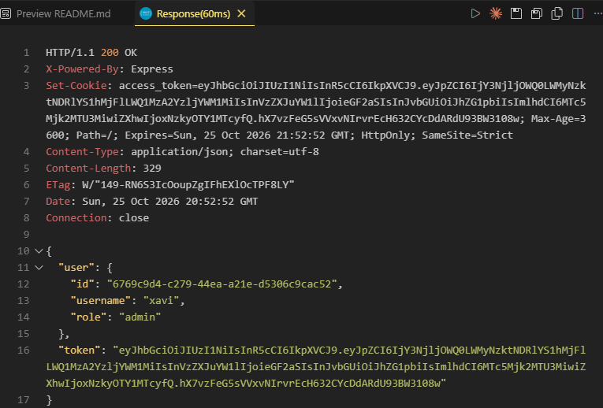
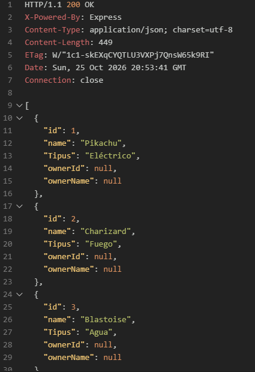
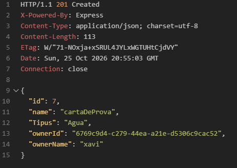
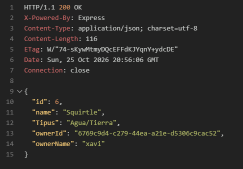
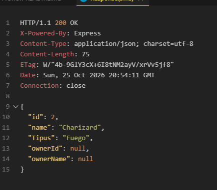
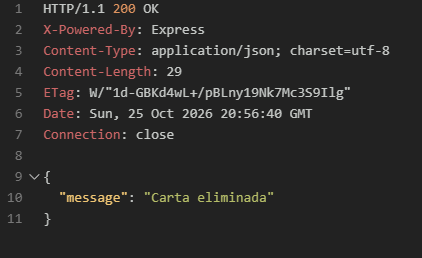
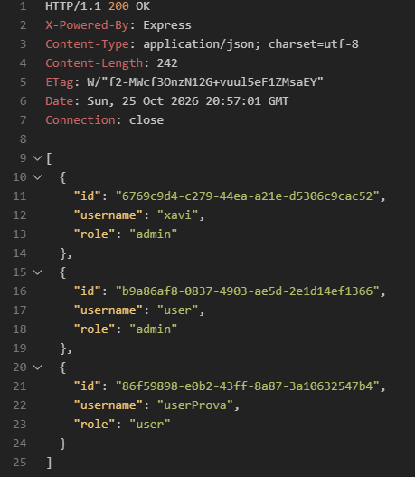
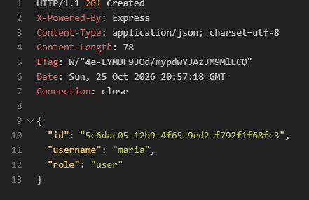

# Sistema complet amb autenticació i CRUD

Aplicació feta amb Node.js i Express que combina autenticació amb JWT i una API REST amb dos CRUD complets: **pokemons** (cartes) i **users**. El frontal es fa amb plantilles EJS.

## Instal·lació i execució

```bash
npm install
npm start        # node index.js
npm run dev      # amb nodemon
```

L'aplicació s'obre a `http://localhost:3000`.

## Dades d'exemple

Els fitxers `db/users.json` i `db/pokemons.json` porten dades d'exemple. Usuari administrador per provar:

- Username: `xavi`
- Password: `123456`

## Autenticació

El login i el registre generen un token JWT que caduca en **1 hora**. Es guarda en una cookie `access_token` amb `httpOnly` i `sameSite: strict` (i `secure` en producció). Les contrasenyes es guarden xifrades amb bcrypt.

El middleware `loadUser` s'executa a totes les peticions i carrega l'usuari a `req.session.user`. El token es pot enviar per cookie (navegador) o per la capçalera `Authorization: Bearer <token>` (Postman / REST Client).

| Mètode | Ruta | Descripció | Accés |
|---|---|---|---|
| GET | `/` | Pàgina d'inici | Públic |
| GET | `/login` | Formulari de login i registre | Públic |
| POST | `/register` | Registra un usuari nou | Públic |
| POST | `/login` | Inicia sessió | Públic |
| POST | `/logout` | Tanca la sessió | Públic |
| GET | `/protected` | Pàgina privada amb dades de l'usuari | Autenticat |
| GET | `/profile` | Dades de l'usuari i les seves cartes | Autenticat |

## CRUD de pokemons

Tots els endpoints requereixen estar autenticat.

| Mètode | Ruta | Descripció | Permisos |
|---|---|---|---|
| GET | `/pokemons` | Llista de pokemons | Autenticat |
| GET | `/pokemons/:id` | Detall d'un pokemon | Autenticat |
| POST | `/pokemons` | Crea un pokemon | Autenticat |
| PUT | `/pokemons/:id` | Modifica un pokemon | Propietari o admin |
| DELETE | `/pokemons/:id` | Elimina un pokemon | Propietari o admin |

Rutes només per al navegador (formularis EJS):

| Mètode | Ruta | Descripció |
|---|---|---|
| GET | `/pokemons/new` | Formulari de creació |
| GET | `/pokemons/:id/edit` | Formulari d'edició |

Camps del cos (JSON o formulari): `name` i `Tipus`, tots dos obligatoris.

## CRUD d'usuaris

Tots els endpoints requereixen estar autenticat **i ser administrador**.

| Mètode | Ruta | Descripció |
|---|---|---|
| GET | `/users` | Llista d'usuaris |
| GET | `/users/:id` | Detall d'un usuari |
| POST | `/users` | Crea un usuari |
| PUT | `/users/:id` | Modifica un usuari |
| DELETE | `/users/:id` | Elimina un usuari |

Rutes només per al navegador (formularis EJS):

| Mètode | Ruta | Descripció |
|---|---|---|
| GET | `/users/new` | Formulari de creació |
| GET | `/users/:id/edit` | Formulari d'edició |

Camps del cos: `username` (mínim 3 caràcters), `password` (mínim 6 caràcters) i `role` (`user` o `admin`). En modificar un usuari, el password és opcional.

## Regles de negoci

- Només els usuaris autenticats poden accedir a les rutes CRUD.
- Els tokens JWT caduquen després d'1 hora.
- Només el propietari d'un pokemon o un admin pot editar-lo o esborrar-lo.
- No es poden repetir pokemons amb el mateix nom.
- Només els admins poden gestionar usuaris.
- Un admin no es pot esborrar a si mateix ni treure's el rol d'admin.
- No es poden repetir noms d'usuari.
- El primer usuari registrat és administrador.

## Respostes i codis d'estat

Si la petició porta `Accept: application/json` (o cos JSON) l'API respon amb JSON. Si ve del navegador, respon amb una plantilla EJS o una redirecció.

| Codi | Significat |
|---|---|
| 200 / 201 | Operació correcta / recurs creat |
| 400 | Dades no vàlides |
| 401 | No autenticat o credencials incorrectes |
| 403 | Sense permisos |
| 404 | Recurs no trobat |
| 409 | Recurs duplicat |

## Proves i captures

També es poden fer les proves amb el fitxer `request.http`. 

### Autenticació

Login correcte (resposta amb token):



### CRUD de pokemons

GET llista i GET detall:



POST crear:



PUT modificar:



Detalls pokemon:



DELETE eliminar:



### CRUD d'usuaris

GET llista, POST i PUT:



POST crear:



PUT modificar:

